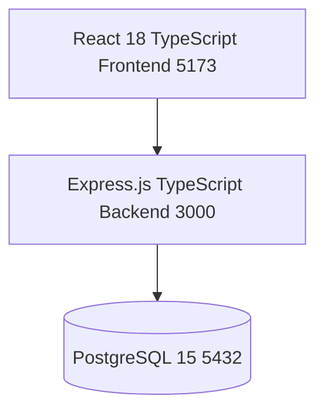
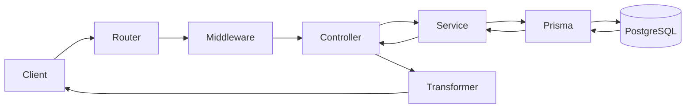
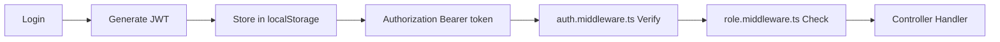

# System Patterns — Society Management Portal

## Architecture Overview



## Backend Architecture (Express.js + TypeScript)

### Layer Structure & Request/Response Flow



### Layer Responsibilities

| Layer | Location | Responsibility |
|-------|----------|---------------|
| **Routes** | `src/routes/*.routes.ts` | Define URL paths, attach middleware + controller handlers |
| **Middleware** | `src/middleware/` | JWT auth, role guard, DTO validation, error handling |
| **Controllers** | `src/controllers/*.controller.ts` | Parse validated request, call service, pass result to transformer, send response |
| **Services** | `src/services/*.service.ts` | All business logic, all DB queries via Prisma — returns raw Prisma objects |
| **DTOs** | `src/dtos/*.dto.ts` | Zod schemas for **request (input)** validation only |
| **Transformers** | `src/transformers/*.transformer.ts` | Shape **response (output)** — strip sensitive fields, add computed fields |
| **Utils** | `src/utils/` | Pure functions: JWT sign/verify, bcrypt hash/compare, date math |
| **Helpers** | `src/helpers/` | Domain helpers: billing calc, pagination |
| **Models** | `src/models/` | Re-exports from `@prisma/client` — TypeScript model types |

### Key Rules
> Controllers MUST NOT contain business logic. All logic lives in services.
> Services MUST NOT parse `req`/`res` — they are pure functions receiving typed arguments.
> Transformers MUST NOT query the database — they only shape data already returned by services.
> DTOs are for INPUT (request body validation). Transformers are for OUTPUT (response shaping).
> Raw Prisma objects MUST NEVER be sent directly to the client — always pass through a transformer.

## Module Breakdown

### Backend Modules (Express Routers)
| Router | Responsibility |
|--------|---------------|
| `auth` | Login, refresh token, change-password, me |
| `flats` | CRUD for flat records |
| `residents` | CRUD for resident profiles, flat assignment |
| `billing` | Generate bills, list bills (with dynamic late fee), record payments, mark-overdue |
| `settings` | Read/update `societySettings` singleton (admin only for write) |
| `visitors` | Log entry (+ notification to resident), log exit, list |
| `assets` | Track lifts, borewell, water tank service records |
| `parking` | Manage 40 slots, assign to flat/vehicle |
| `notices` | Post/list/delete society notices |
| `complaints` | Raise complaint, update status, admin remark |
| `staff` | Staff profiles, creates security user account |
| `notifications` | In-app notification inbox per user |
| `directory` | Resident directory (name + flat, no PII) |

### Frontend Pages
| Page | Role Access |
|------|-------------|
| `/login` | All |
| `/admin/dashboard` | Admin |
| `/admin/flats` | Admin |
| `/admin/residents` | Admin |
| `/admin/billing` | Admin |
| `/admin/payments` | Admin |
| `/admin/visitors` | Admin |
| `/admin/assets` | Admin |
| `/admin/parking` | Admin |
| `/admin/staff` | Admin |
| `/admin/notices` | Admin |
| `/admin/complaints` | Admin |
| `/admin/settings` | Admin |
| `/resident/dashboard` | Resident |
| `/resident/bills` | Resident |
| `/resident/complaints` | Resident |
| `/resident/notices` | Resident |
| `/resident/visitors` | Resident |
| `/resident/directory` | Resident |
| `/guard/visitor-entry` | Security Guard |

## Key Design Patterns

### Role-Based Access Control (RBAC)
- JWT token payload contains `userId`, `role`, `flatId` (for residents)
- `auth.middleware.ts` verifies token and attaches user to `req.user`
- `role.middleware.ts` factory: `requireRoles('admin', 'owner')` — throws 403 if role not allowed
- Frontend `ProtectedRoute` component redirects unauthorized roles
- Roles: `admin`, `owner`, `tenant`, `security`

### DTO Validation Pattern
- Every request body is validated by a Zod schema defined in `src/dtos/`
- `validate.middleware.ts` runs `schema.parse(req.body)` — returns 422 on failure
- Controller receives `req.body` already typed and validated
- DTOs are **input-only** — they define what the API accepts, not what it returns

### Transformer Pattern
- Every API response is shaped by a transformer function defined in `src/transformers/`
- Transformers receive raw Prisma model objects and return safe, typed response objects
- Responsibilities:
  - Strip sensitive fields (e.g. `passwordHash` never leaves the server)
  - Add computed fields (e.g. `lateFee`, `totalDue` on billing responses)
  - Rename or restructure fields for clean API contracts
- Controllers call the transformer before `res.json()`: e.g. `res.json(transformBill(bill, settings))`
- Transformers are pure functions — no DB calls, no side effects
- Example: `billing.transformer.ts` — takes `MaintenanceBill` + `SocietySettings`, returns `{ ...bill, lateFee, totalDue }`
- Example: `directory.transformer.ts` — returns `{ name, flatNumber, floor, flatType }` only (strips phone/email)

### Maintenance Billing Pattern
- Billing formula fully configurable via `societySettings` table
- Formula: `amount = (flat.sqFt × ratePerSqft) + fixedCharge`
- Bills generated in bulk by admin for a given month/year
- One bill record per active flat per month
- Bill status lifecycle: `unpaid` → `paid` (or `overdue` after due date)
- Payment record linked to bill with mode (cash/UPI/bank)
- `billing.helper.ts` contains the calculation function — used by `billing.service.ts`

### Late Fee Pattern
- Late fee parameters stored in `societySettings`:
  - `lateFeeGraceDays` — days after due date before fee starts
  - `lateFeePerDay` — ₹ per day (default ₹10)
- Late fee calculated **dynamically** when bill is fetched (never stored in DB)
- Formula: `lateFee = max(0, daysSinceDue - graceDays) × lateFeePerDay`
- `billing.helper.ts` exports `calculateLateFee(dueDate, settings)` function
- `billing.transformer.ts` calls `calculateLateFee()` and appends `lateFee` + `totalDue` to response

### Society Settings Pattern
- Single-row table `societySettings` (only one record, always id=1)
- Admin edits via `/admin/settings` page
- Backend `GET /api/v1/settings` (all roles can read) / `PUT /api/v1/settings` (admin only)
- Fields: `ratePerSqft`, `fixedCharge`, `lateFeeGraceDays`, `lateFeePerDay`

### Visitor Notification Pattern
- Guard POSTs visitor entry → DB record created
- `visitor.service.ts` creates notification record for the resident of that flat
- Resident polling (`GET /api/v1/notifications/me`) picks up notification
- Exit time updated when guard logs exit

### Asset Service Tracking Pattern
- Each asset has `lastServiceDate` and `nextServiceDue`
- Admin dashboard flags assets where `nextServiceDue <= today + 7 days`

### Resident Directory Pattern
- Available to all residents (owner + tenant)
- Shows: `name`, `flatNumber`, `floor`, `flatType`
- Excludes: `phone`, `email` (privacy — admin-only fields)
- `directory.transformer.ts` enforces the exclusion — phone/email never appear in directory responses

## Database Table Relationships

```
flats (1) ----< residents (many)
flats (1) ----< maintenanceBills (many)
maintenanceBills (1) ----| payments (0 or 1)
flats (1) ----< visitors (many)
flats (1) ----| parkingSlots (0 or 1)
flats (1) ----< complaints (many)
users (1) ----| residents (0 or 1)
users (1) ----| staff (0 or 1)
societySettings (singleton row, id=1)
```

## Key DB Tables Summary
| Table | Purpose |
|-------|---------|
| `flats` | flatNumber, floor, type, sqFt, status |
| `residents` | name, email, phone, flatId, residentType (owner/tenant) |
| `users` | username, passwordHash, role, residentId/staffId |
| `maintenanceBills` | flatId, month, year, amount, status, dueDate |
| `payments` | billId, amountPaid, paidOn, paymentMode |
| `visitors` | visitorName, flatId, purpose, entryTime, exitTime |
| `assets` | name, type, status, lastServiceDate, nextServiceDue |
| `parkingSlots` | slotNumber, flatId, vehicleNumber |
| `notices` | title, body, priority, postedOn |
| `complaints` | flatId, category, description, status, adminRemark, raisedOn |
| `staff` | name, role, shift, joinDate |
| `notifications` | userId, message, flatId, isRead, createdAt |
| `societySettings` | ratePerSqft, fixedCharge, lateFeeGraceDays, lateFeePerDay |

## Authentication Pattern (JWT)



## Key Design Decisions

1. **Late fee not stored** — calculated dynamically on fetch via `billing.helper.ts`
2. **Singleton settings** — `societySettings` always id=1, seeded on first migration
3. **Bulk bill generation** — one bill per active flat per month
4. **In-app notifications only** — no SMS/email in v1
5. **No payment gateway** — manual payment recording by admin
6. **Security restriction** — resident directory hides PII (phone/email) enforced by `directory.transformer.ts`
7. **Zod DTOs** — input validation only; `validate.middleware.ts` runs before controller
8. **Transformers** — output shaping only; controllers call transformer before `res.json()`; no raw Prisma objects sent to client
9. **Prisma ORM** — schema-first with `prisma/schema.prisma`
10. **Controllers are thin** — parse req, call service, call transformer, send response only